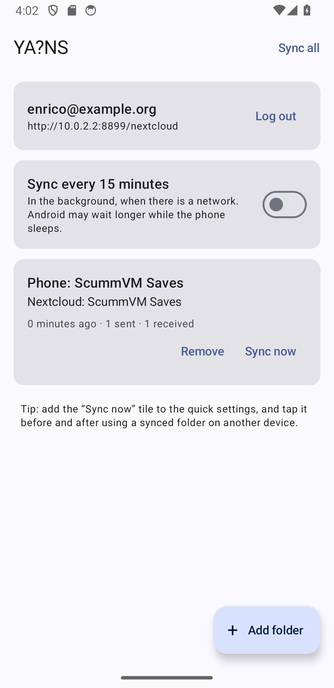

# YA?NS — Yet Another (?) Nextcloud Sync

> **Generated with AI.** The code of this app was written by Claude, Anthropic's AI model.

Two-way sync of folders on an Android phone with folders on a Nextcloud. It began with ScummVM's saved
games, which its own cloud sync cannot keep on a Nextcloud: there turned out to be no free app that syncs
a folder both ways with Nextcloud. Hence the name: *yet another*… or not.



| Module | What it is                                                                                       |
|--------|--------------------------------------------------------------------------------------------------|
| `core` | The sync, in plain Kotlin with OkHttp: Nextcloud's login, WebDAV, and the two-way sync. Tested on the computer. |
| `app`  | The Android app: Compose screens, folders chosen in Android's folder picker, the background job, the tile. |

## Build and run

```sh
./gradlew :core:test                  # the sync, against a fake Nextcloud
./gradlew :app:assembleDebug          # APK in app/build/outputs/apk/debug
./gradlew :app:assembleRelease        # shrunk with R8, unsigned
```

Needs JDK 17 or later (a full JDK, with `javac`) and the Android SDK (`local.properties` or `ANDROID_HOME`).
Nothing in the app is proprietary or from Google Play services.

**Trying it on the emulator** without a real Nextcloud: `YANS_SERVE=1 ./gradlew :core:test --tests
'*ServeFakeNextcloud*'` serves a fake one on port 8899 for 30 minutes. In a debug build, log in with an app
password: address `http://10.0.2.2:8899/nextcloud`, user `enrico@example.org`, password `app-pass`. Only
debug builds may reach that address without TLS.

## How it works

**Logging in.** Nextcloud's [login flow v2](https://docs.nextcloud.com/server/latest/developer_manual/client_apis/LoginFlow/index.html#login-flow-v2):
the app opens the server's login page in the browser and asks the server every two seconds whether the user
approved; the server then hands it an app password of its own, listed as "YANS (Android)" in Nextcloud's
*Settings → Security → Devices & sessions*, where it can be taken back. An app password made there by hand
can be typed in instead. The app asks the server for the account's user id, which its WebDAV address is
made of, since it can differ from the name used to log in.

**Folders.** Each folder on the phone is chosen in Android's folder picker, which lends the app that folder
alone, for good; it is paired with a folder on Nextcloud, typed (`Games/ScummVM Saves`, made when missing) or chosen by
browsing the server's folders, where a new one can be made too.
Subfolders are synced too. Folders on shared storage (`Documents/…`) are the ones other apps can use as well;
Android does not let the picker choose `Android/data`.

**The sync.** For each pair the app keeps, file by file, how the file was on both sides when they last
agreed: the server's ETag, and the phone's size and time. A sync lists both sides and compares each file
with that:

- changed on one side only: copied to the other side;
- deleted on one side, unchanged on the other: deleted there too (on Nextcloud it goes to the trash bin);
- deleted on one side, changed on the other: the change wins, and the file comes back;
- changed on both sides, or met for the first time on both: if both hold the same bytes, nothing to do.
  Otherwise the newer one stays under its name and the older one is kept, on both sides, as
  `name (conflict 2026-10-29 15.30.12).ext`. ScummVM, which looks for `game.001`, ignores those copies.

Files travel through the app's cache, whole, before they are written on the other side, so a connection lost
halfway never leaves half a file. A file that fails is reported and the others go on. If one side lists no
files at all where the last sync left some (a card taken out, the server's folder renamed), the sync stops
rather than delete everything on the other side.

Uploads tell Nextcloud the file's time (`X-OC-Mtime`), so the server keeps it. Android lets no app set a
file's time, so a file downloaded to the phone has the time it was downloaded; that only matters to tell
which of two conflicting changes is newer, and a change made on the phone after the download is newer anyway.

**When it syncs.** *Sync all* and *Sync now* in the app; the *Sync now* tile in the quick settings, which
syncs as soon as there is a network, even with the app closed; and, when turned on, every 15 minutes in the
background, the most often Android allows, and later when the phone sleeps. Only one sync runs at a time. A
sync in the background that meets a conflict or fails says so in a notification.

**Keeping two devices apart.** The sync is reliable when a folder is used on one device at a time: sync
after playing on one, before playing on the other. A save changed on both in between is not lost, but it
becomes a conflict copy to look at.

## Not yet

- Uploads of files larger than the server takes in one request (Nextcloud's chunked upload).
- WebDAV servers other than Nextcloud (the sync would work; the login is Nextcloud's).

## Licence

GPL-3.0-or-later. See [LICENSE](LICENSE).
